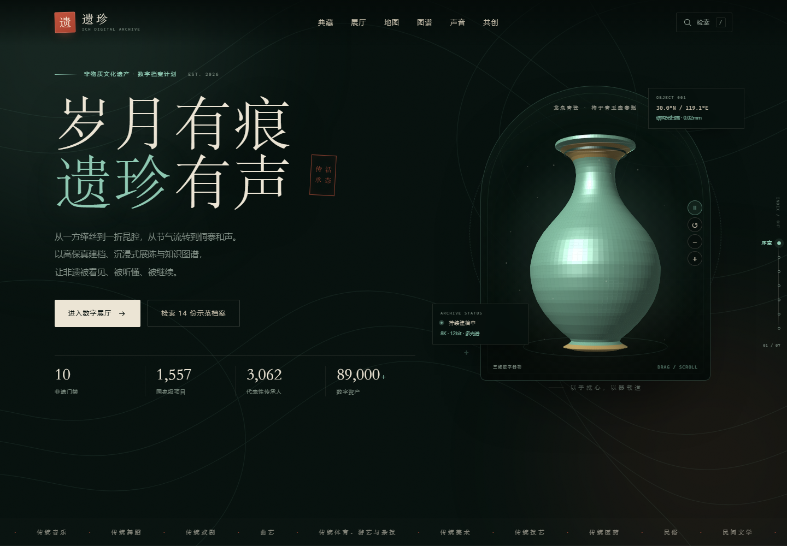
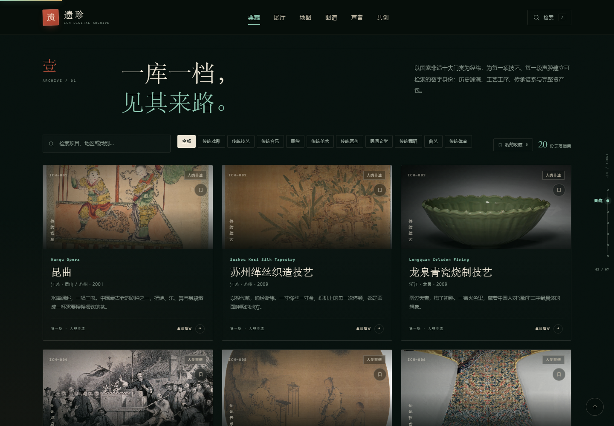

# 遗珍 · 非物质文化遗产数字档案馆

一个以「新中式 / 现代学术馆」为视觉方向构建的非遗数字档案馆前端概念站。围绕原规划中的 **存、展、传** 三条主线，将档案检索、三维器物、全景戏台、非遗地图、知识图谱、声音博物馆与公众共创整合为一个可直接浏览的沉浸式单页网站。20 份示范档案均配有可溯源的博物馆与馆藏真实影像，出处与许可见 [credits.html](credits.html)。

> 本站为设计概念演示，非官方平台。页面中的档案、传承人、统计数据与资产数量为示例或公开资料整理，不作为学术引用依据。



## 快速开始

无需构建工具或后端服务，直接打开：

```text
index.html
```

也可以在本目录启动一个静态服务器：

```bash
python -m http.server 8000
```

然后访问 `http://localhost:8000`。

推荐使用最新的 Chrome / Edge / Safari。所有交互均为原生 HTML、CSS 与 JavaScript，没有外部依赖，可离线运行。

## 已实现模块

### 壹 · 典藏档案
- 覆盖国家非遗十大门类的 20 份示范档案：昆曲、缂丝、龙泉青瓷、皮影戏、古琴、云锦、侗族大歌、二十四节气、太极拳、剪纸、格萨尔、针灸、农乐舞、苏州评弹、京剧、端午节、中国书法、雕版印刷技艺、蒙古族长调民歌、妈祖信俗。
- 支持按门类筛选、按项目 / 地区 / 类别实时检索、展开全部。
- 每份档案包含：项目编号、类别、申报地区、级别、批次、年份、保护单位、历史渊源、工艺特征、工序、传承谱系、数字资产包。
- 元数据字段参考 Dublin Core，并在界面中保留批次、传承人编码、地理坐标、资产哈希等扩展位。
- 档案详情以模态层呈现，带焦点管理与键盘操作。

### 贰 · 数字展厅
- **三维青瓷玉壶春瓶**：Canvas 2D 程序化旋转体渲染，支持拖拽旋转、滚轮缩放、双击复位、方向键 / 加减号键盘控制；带工作室布光、地面阴影与浮动微粒。
- **360° 环绕展厅**：点击器物或「可旋转的器物」展项进入大画布环绕模式，任意方向拖拽 360° 旋转、缩放、自动旋转与复位，Esc 退出。
- **皮影戏全景舞台**：内联 SVG 场景 + 透视 3D 随鼠标转动，月亮、山体、幕布、红幕、尘埃分层视差，追光随指针移动；幕布内嵌真实纪录片《四川非遗100 · 皮影人生》（中国非物质文化遗产网，已压缩转码随站托管），点击开演即播放；视频不可用时自动切换三折皮影小戏《武松打虎》《三打白骨精》《白蛇传》并逐句字幕，支持暂停与全屏。
- **多光谱还原**：入库影像与复原影像拖动对比，可见光 / 紫外荧光 / 红外三种波段一键切换。
- **声音博物馆入口**：展项面板列出五段声音，点击曲目自动跳转声音博物馆并开始播放。
- 数字建档标准条：三维精度、色彩位深、音频采样、影像像素。

### 叁 · 时空地图
- 以流域、省域为经纬的抽象非遗分布图，含黄河 / 长江、区域标注、指北针与比例尺。
- 10 个地点节点，按 UNESCO 名录列入年份支持时间筛选。
- 桌面端点击节点更新右侧地方档案卡；平板端档案卡移到地图下方；手机端提供可读性更好的「地点索引」列表。

### 肆 · 知识图谱
- 以「皮影戏」为中心的 17 个节点、19 条关系，覆盖项目、传承人、流派、剧目、技艺、材料、地域。
- Canvas 力导向布局，支持拖拽节点、点击查看关联、类型筛选、双击复位。
- 右侧面板展示节点释义与关联节点，关联标签可继续点击漫游。

### 伍 · 声音博物馆
- 五段声音条目：昆曲、古琴、侗族大歌、蒙古族长调、苏州评弹。
- 使用 Web Audio API 实时合成意象音景，环形频谱随声音律动，支持切换、暂停。
- 声音文本区提供「唱词 / 题解」「英译」「聆听笔记」三种视图。
- 明确标注：演示音频为实时合成，并非原始录音。

### 陆 · 公众共创
- 线索征集 / 研学预约 / 合作共建三类入口。
- 表单校验、提交成功状态、本地 `localStorage` 留存演示记录。
- 公众线索、合作机构、研学人次计数动画。

### 体验增强
- **章节索引**：宽屏右侧固定索引随滚动更新，显示 01—07 的阅读位置；移动端自动隐藏，保留顶部目录。
- **个人收藏**：每份档案右上角可加书签，档案详情内也可收藏；工具栏「我的收藏」可只看收藏，刷新后仍保留。
- **可分享档案**：打开档案会写入 `#archive/<id>` 深链接，支持刷新直达、浏览器前进 / 后退；详情内「分享」一键复制链接。
- **档案漫游**：支持「随机翻阅」；详情底部提供「上一份 / 下一份」，无需反复关闭档案即可连续浏览。
- **档案征集位**：展开全部档案后，末行自动补入「你的线索，也许就是下一份档案」征集卡，避免奇数卡片留下空位。
- **项目图像**：20 份档案均配真实影像，卡片与档案详情共用；图像来源、馆藏编号与许可见 [credits.html](credits.html)。
- **档案特色**：每份档案详情均以项目专属强调色渲染，并新增「一句话金句 + 三个核心特征」特色条，20 份档案各不相同。
- **器物控制**：三维青瓷支持自动旋转开关、视角复位、放大 / 缩小，以及原有的拖拽、滚轮与键盘控制；点击器物进入全屏 360° 环绕模式。
- **全景戏台**：鼠标移动带透视 3D 环绕与追光，开演后播放真实皮影戏纪录片，视频不可用时自动切换三折皮影小戏并逐句字幕。
- **图谱缩放**：知识图谱支持滚轮缩放、拖拽空白处平移、＋/－/复位按钮，节点拖拽与点击漫游保持不变。
- **地图门类筛选**：图例从静态说明改为可点击筛选，可与时间范围组合；无匹配结果时显示空状态。
- **声音音量**：新增音量滑杆与静音按钮，音量写入本地并在下次访问时恢复。
- **表单体验**：字段级错误提示、联系方式格式校验、600 字实时计数、草稿自动保存与恢复；提交后根据「线索 / 研学 / 合作」显示对应回执。
- **检索键盘操作**：`/` 或 `Ctrl/Cmd + K` 打开检索，`↑ ↓` 在结果间移动，`Enter` 打开，`Esc` 关闭。

## 视觉系统

| 角色 | 色值 | 说明 |
| --- | --- | --- |
| 墨底 | `#07110e` | 深墨绿黑，替代纯黑 |
| 宣纸 | `#ece5d5` | 正文与主按钮 |
| 青瓷 | `#8fc9b3` | 主强调色，取自梅子青 |
| 朱砂 | `#d15a42` | 印章、索引与关键强调 |
| 金 | `#c7a86a` | 档案、时间与工艺细节 |
| 次要文字 | `#92a096` | 正文辅助信息 |
| 弱化文字 | `#78887d` | 小号标签（对比度约 5.1:1） |

字体优先使用系统宋体 / 黑体组合：`Songti SC / STSong / Noto Serif SC / SimSun` 用于标题与档案文本，`PingFang SC / HarmonyOS Sans SC / Microsoft YaHei` 用于界面。没有加载外部字体，避免网络依赖。

## 交互与可访问性

- 响应式断点：1180 / 1000 / 900 / 680 / 420px。
- 移动端导航、筛选条、地图索引、模态层均可用触控操作。
- 全站键盘可达；模态层含焦点陷阱与 Esc 关闭。
- 装饰性图形 `aria-hidden`，地图节点、图谱说明、音频按钮均提供可读标签。
- 支持 `prefers-reduced-motion`：关闭跑马灯、自动旋转与大部分过渡。
- 文字对比度按 WCAG AA 方向调整；主内容支持 200% 缩放。

### 本地数据

概念站不向服务器上传任何内容，仅使用浏览器 `localStorage` 保存演示状态：

| Key | 内容 |
| --- | --- |
| `yizhen-bookmarks` | 收藏的档案 ID |
| `yizhen-draft` | 未提交的共创表单草稿 |
| `yizhen-clues` | 最近提交的演示线索 |
| `yizhen-volume` | 声音博物馆音量 |

清除浏览器站点数据即可重置全部状态。

## 文件结构

```text
.
├── index.html      # 页面结构与内容
├── styles.css      # 视觉系统、布局、响应式
├── app.js          # 数据模型与全部交互
├── credits.html    # 图像与资料说明
├── preview.png     # 首页预览
├── preview-archive.png # 档案库图像预览
├── preview-project.png # 档案详情页预览
├── preview-exhibition.png # 数字展厅预览
├── README.md
├── assets/
│   ├── images/     # 20 张项目真实影像（JPEG，含来源与许可）
│   └── videos/     # 皮影戏纪录片（压缩版，随站托管）
└── _backup/        # 原天气页面备份（非本站内容）
```

`_backup/` 仅用于保留工作目录中原有的天气页面，可安全删除。

## 图像与版权

项目图像位于 `assets/images/`，共 20 张真实影像（JPEG，已统一裁切为 1400×933），对应 20 份示范档案，全部可溯源：

- **克利夫兰艺术博物馆开放获取影像（CC0）**：昆曲戏画、缂丝、龙泉青瓷、听琴图、吉服袍、四季山水册、水浒版画、绿度母唐卡、朝鲜老人面具、中国演员油画、草书手卷、山海经刻本、马上行猎图。
- **惠康收藏（Wellcome Collection，CC BY 4.0 / 公有领域）**：临清木偶戏版画、黑苗吹奏口簧图绘、中国武术拳法、针灸穴位图、John Thomson 1869 年摄广州乐人、土地神节庆图、1870/71 年摄宁波天后宫。



其中少数为与项目相关的历史图像或邻近文化示例（侗族大歌、皮影戏、剪纸、农乐舞、格萨尔等使用示意图像），已在 [credits.html](credits.html) 逐张标注馆藏编号、出处、许可与「示意」说明；正式建馆时应替换为与项目一一对应的授权实拍。

## 数据模型建议（对接后端时）

核心项目表 `project`：

| 字段 | 类型 | 说明 |
| --- | --- | --- |
| `project_id` | varchar | 项目编号，如 `ICH-001` |
| `title` | varchar | 项目名称 |
| `title_en` | varchar | 英文名 |
| `category` | varchar | 十大门类 |
| `region` | varchar | 申报地区 |
| `level` | varchar | 国家级 / 人类非遗代表作 |
| `batch` | varchar | 公布批次 |
| `listed_year` | int | 列入年份 |
| `protection_unit` | varchar | 保护单位 |
| `summary` | text | 一句话摘要 |
| `history` | text | 历史渊源 |
| `craft` | text | 工艺特征 |
| `steps` | json | 工序步骤 |
| `coordinates` | point | 地理坐标 |
| `cover_asset_id` | varchar | 封面资产 |
| `dublin_core` | json | DC 15 项元素映射 |
| `status` | varchar | 建档 / 核校 / 发布 |

多对多关系：

```text
project 1 ──< project_inheritor >── 1 inheritor
project 1 ──< project_asset >── 1 asset
project 1 ──< project_relation >── 1 project
```

`inheritor` 单独存表，字段包括 `inheritor_id`、姓名、级别、批次、流派、传承谱系、口述史资产、地理坐标；`project_inheritor` 增加 `role`（代表性传承人 / 歌师 / 保护单位）与 `start_year`，以支持同一人跨项目、跨流派的复杂关系。

知识图谱可将 `project`、`inheritor`、`school`、`play`、`craft`、`place`、`material` 映射为 Neo4j 节点，将「传承」「代表」「流派」「剧目」「技艺」「材料」「流行于」映射为关系；前端当前使用 Canvas 演示布局，正式版可替换为 Neo4j + 图查询 API。

## 生产化建议

当前版本聚焦「可看、可听、可交互」的前端概念验证。正式建设时建议补齐：

1. **DAMS 后台**：Spring Boot / Go 服务，支持大文件分片上传、转码队列、元数据审核、版权水印与资产版本。
2. **对象存储与分发**：OSS / COS + CDN，视频 HLS 切片，音频 96kHz 无损与流式双版本。
3. **三维管线**：结构光 / 摄影测量扫描，GLB 压缩（Draco / KTX2），LOD 分级与移动端降级。
4. **知识图谱**：Neo4j 存储与 Cypher 查询，前端图可视化替换当前演示布局。
5. **检索**：Elasticsearch / OpenSearch，支持中文分词、字段加权与同义词。
6. **权限与版权**：传承人授权书、资产水印、访问级别、学术引用与商用授权流程。
7. **内容治理**：与保护单位、研究机构共建审校流程；所有传承人信息以官方名录为准。

## 数据与版权说明

- 页面中的项目历史、工艺与传承人信息依据公开资料整理，仅用于界面与交互演示。
- 统计数字（1,557 项国家级项目、3,062 位代表性传承人）为公开常引数据；资产数量、公众线索、合作机构等为演示数据。
- 所有图片均为 CSS / SVG / Canvas 程序化生成，不使用外部图片素材。
- 「遗珍」为概念站名称，不代表任何官方机构。
